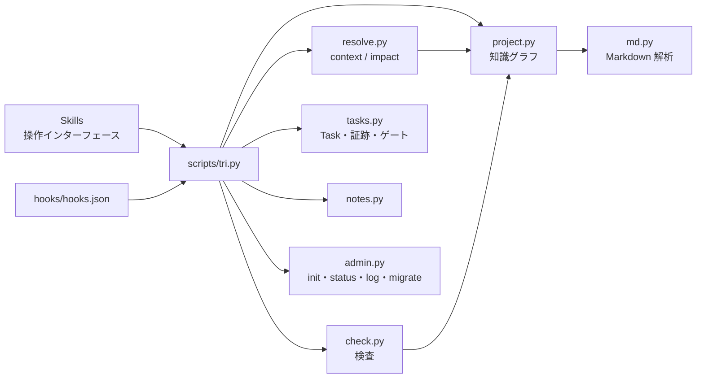

# アーキテクチャ

## 構成

| 要素 | 責務 | 実装 |
|---|---|---|
| Skills | エージェントへの手順（いつ・どのコマンドを使い・何を判断するか） | `skills/` |
| CLI | 決定的処理の入口。Python 3.9+ の標準ライブラリのみ（REQ-0009） | `scripts/tri.py` |
| 知識グラフ | 文書の分類・セクション・ID 定義・エッジを毎回元データから導出する。索引ファイル・キャッシュは持たない | `scripts/trissd/project.py` |
| Markdown 解析 | frontmatter・見出し・ID・リンク・コードパス・トークン推定 | `scripts/trissd/md.py` |
| Hooks | セッション開始時の状況注入と、Docs 編集直後の検査 | `hooks/hooks.json` |

Skills は [知識モデル](knowledge-model.md) と [記載規約](writing-rules.md) を参照し、規約を複製しない。

## 知識グラフ

ノードはセクション（`パス#見出しslug`。見出し前の部分は `パス`）とコードパス。REQ-0001 の分類はパスで決まる（`project.classify`）。

| エッジ | 導出元 |
|---|---|
| contains | 見出しの階層 |
| ref | 地の文の ID → その ID を定義するセクション |
| link | Markdown リンク・実在する `docs/*.md` のインラインコード |
| depends | frontmatter `refs` / `depends` / `requires` |
| code | 実在するパスのインラインコード・frontmatter `code` |
| code-id | コード（docs/ と Markdown 以外の git 管理ファイル）に書かれた ID（`git grep` で毎回求める） |

ID の定義: Task は frontmatter `id`、REQ は Goal・Docs の見出しの先頭の ID（旧形式の `- **ID**: REQ-nnnn` 行も可）。

## 関連知識の取得

`context` は REQ-0002 を実現する。起点からスコア 1.0 で最良優先探索し、辺ごとの重みを掛けて減衰させる。
到達経路（モード）ごとに辿れる辺を制限し、兄弟セクションや広い範囲を統治する文書への横移動で膨らまないようにする。

| 到達経路 | 重み | 次に辿れる辺 |
|---|---|---|
| 起点（Task はファイル全体） | 1.0 | すべて |
| fwd: 参照先（Task から 0.95、ref 0.8・link 0.75・depends 0.9） | 左記 | 参照先・配下・作業範囲のコード以外すべて |
| down: 配下の見出し | 0.9 | fwd と同じ |
| up: 親見出し | 0.5 | 親だけ（親の本文だけを読む） |
| code: 起点・Task の作業範囲のコード | 0.95 | そのコードを包含して記述する Docs（gov） |
| gov: コードを記述する Docs（名指し 0.9・包含 0.7） | 左記 | 配下だけ（0.75 で減衰） |
| real: REQ を参照する設計 | 0.6 | 配下だけ |
| Note からの被参照 | 0.8 | なし |
| Docs・Task からの被参照（REQ 以外） | 0.35・0.4 | なし |

選定規則:

1. 起点の全セクション・Goal 全体・起点からの直接参照先とその配下を**必須**にする
2. 必須以外はスコア 0.3 以上を選定し、0.3 未満は「関連の弱い候補」として列挙だけする
3. 必須を先頭にスコア順で予算内に詰める。予算を超えた必須は省略一覧に出し、終了コード 3 を返す
4. 起点の Task から参照が1本も出ていないとき、または `--query` を指定したときは、BM25 キーワード探索の結果を起点に加え、印を付ける
5. 起点の Task 本文との語彙の一致（BM25）で、グラフで辿れない節を補う。既に関連と判定した Docs と同じ文書内の節（正規化スコア 0.4 以上）は選定し、それ以外の上位 5 件は「関連の弱い候補」として本文を出さずに列挙する
6. 選定した節が定義する ID を書いたコード、選定した節が名指しするコード・統治するコードを「関連コード」として示す

完了 Task・CHANGELOG は探索しない。トークン数は ASCII 4 文字・非 ASCII 1 文字を 1 トークンとする推定値である。

## 変更影響の逆引き

`impact` は REQ-0003 を実現する。グラフを依存元の向きに辿る。

- コードの変更: そのパスを名指し（1.0）または包含して記述するセクション。包含は具体性で重み付けする（0.85 × 言及パスの深さ ÷ 変更パスの深さ。0.3 未満は出さない）
- コードに書かれた ID: その ID を定義するセクション（0.95）
- 文書の変更: 変更行を含むセクション（`--git` は差分の行範囲から特定）を参照・リンクするセクション（0.9）
- 上記を参照するセクションまで 1 段だけ間接的に広げる（0.6 倍）
- 進行中 Task は別に列挙し、Docs から参照されない変更パスは対応不要の候補として示す
- ADR など履歴を書く文書（`kind: adr|history`・`docs/adr/`）は書き換えないので対象にしない

## 検査

`check` は REQ-0004 を実現する。参照切れ・ID 重複・Task 書式・完了済み Task を指す計画マーカーはエラー、それ以外は警告（判断はエージェント）。
完了 Task・CHANGELOG・Task の検証記録は書かれた時点の履歴なので、参照切れの対象にしない。

| 検査 | 方法 |
|---|---|
| 履歴汚染 | 過去との対比・変更経緯の言い回し（日英）・日付や版で始まる行・取り消し線・変更履歴見出し。ADR・`kind: history`・Task・Note・`<!-- tri:ok -->` 行は対象外 |
| 重複記述 | Goal・Docs の段落を正規化し、4-gram の Jaccard 係数 0.8 以上を重複とする |
| 肥大化 | Goal 1500・Docs 4000 推定トークン超 |
| 作業差分（`--changed`） | Docs 変更時の CHANGELOG 未更新・既存文書への削除の少ない大量追記・リリース済み CHANGELOG 行の削除（移動は除く） |

## 完了ゲート

`task close` は REQ-0005 を実現する。以下をすべて満たすと `status: done` にして `docs/tasks/_done/` へ移す。

1. 受け入れ条件が1つ以上ある
2. 全 AC の最新の検証記録が PASS
3. コマンドの証跡の作業ツリー指紋が現在と一致する。指紋は `docs/`・`.tri-ssd/`・`CHANGELOG.md` を除く作業ツリーの git tree id（コミットの有無に依存しない）。手で確かめた記録は指紋で失効させない
4. Goal・Docs にこの Task を指す `（計画: T-nnnn）` が残っていない
5. この Task に関係する文書（Task 自身・参照先・着手後に差分のある文書）に `check` のエラーが無い。無関係な文書の誤りでは止めない

`--force` は理由を検証記録に残して完了させる。ゲートを厳しくしすぎると強制完了が常態化して信用を失うため、機械で確実に判定できる条件だけをゲートにする。

### 着手時点との比較

`task verify --against-base` は、通った検証コマンドを着手時点（`base`）のコードでも実行する。base の作業ツリーを一時的に作り、検証コマンドが名指しする変更済みファイル（新しいテスト等）だけを現在の内容で重ねる。

- 着手時点では落ちる: 検証は変更を確かめている
- 着手時点でも通る: 振る舞いを変えない Task でなければ、検証は変更を確かめていない（警告。ゲートではない）

結果は検証記録に `AC1 着手時点 FAIL` の形で残り、報告に表示される。

### 報告

`task report` は、人間がコードを読む代わりに読む報告を既存の記録から組み立てる: 目的の状態・満たす仕様（refs の見出しと1行目）・AC ごとの方法と結果と着手時点との比較・`## 判断` 節・着手後の変更ファイル・CHANGELOG の記載。

### 書かれていない依存の候補

完了時に、context が選ばなかったのにこの Task で必要になった Docs を示す（ゲートではなく提案）。基準は `task start`（または最初の `task verify`）が frontmatter に記録する `started`（時刻）と `base`（コミット）。

- 変更: `base` から現在までに差分のあるコードを、名指し・包含して記述するセクション（逆引きと同じ規則）
- 参照: `started` 以降に Read・Bash で参照した `docs/` の節（`.tri-ssd/reads.log`。git 管理外）

エージェントは必要だったものを Task の `refs` や仕様本文のリンクとして書き足す。次回から context に入る。

## フック

| イベント | 処理 |
|---|---|
| SessionStart（startup・resume・clear・compact） | `status --hook`: Tri-SSD プロジェクトなら状況を出力し文脈に入れる（REQ-0007）。そうでなければ何も出さない |
| PostToolUse（Edit・Write・MultiEdit） | `check --hook`: 編集した `docs/` の文書に関する指摘だけを `additionalContext` で返す |
| PostToolUse（Read・Bash） | `track --hook`: `docs/` の文書の参照を `.tri-ssd/reads.log` に記録する（出力なし） |

フックは `python3`、次に `python` で実行し、どちらも無ければ何もしない（Skill の手順だけで全機能が使える。フックは自動化の保険）。

## テスト戦略

- 単体・結合テストは標準ライブラリの unittest（`tests/`）。フィクスチャは `tests/fixtures/`
- 長期運用は `tests/simulate.py` が操作列を決定的に再現し、健全性の不変条件を `tests/test_simulation.py` が検証する
- コンテキスト効率は `tests/eval_context.py` が実測する。結果は [評価](evaluation.md)
