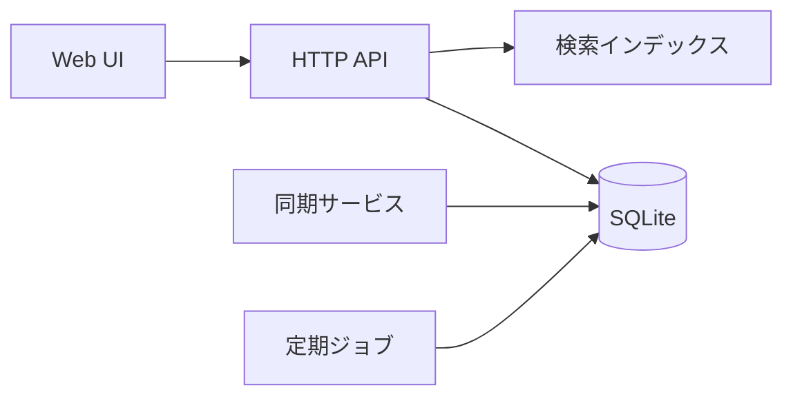

# アーキテクチャ

## 構成

| コンポーネント | 責務 | 実装 |
|---|---|---|
| HTTP API | 認証・入力検証・ユースケースの実行 | `src/api/` |
| Storage | 永続化とトランザクション | `src/storage/` |
| Search | 全文・タグ検索 | `src/search/` |
| Sync | 端末間の差分同期 | `src/sync/` |
| UI | ブラウザ向け画面 | `src/ui/` |
| Worker | リンク確認・ゴミ箱の定期処理 | `src/worker/` |

## 技術スタック

- 言語: Python 3.12、Web フレームワークは Starlette
- 永続化: SQLite（WAL モード）。選定理由は [ADR-0001](adr/0001-sqlite-fts.md)
- 検索: SQLite FTS5（trigram トークナイザ）
- UI: サーバーサイドレンダリング + 最小限の JavaScript

## エラー処理方針

- 利用者の入力誤りは 400 系で返し、フィールド単位のメッセージを付ける
- 外部取得（タイトル取得・リンク確認）の失敗は処理全体を失敗させない。結果に `fetch_status` を記録する
- 予期しない例外は 500 を返し、リクエスト ID 付きで構造化ログに出す
- リトライは冪等な処理だけに限る（最大3回、指数バックオフ）

## テスト戦略

- ユースケース単位の結合テストを主とする（`tests/`、pytest）
- 検索は 10 万件の合成データで性能テストを行う（`tests/perf/`）
- 外部 HTTP はテストではスタブに差し替える
