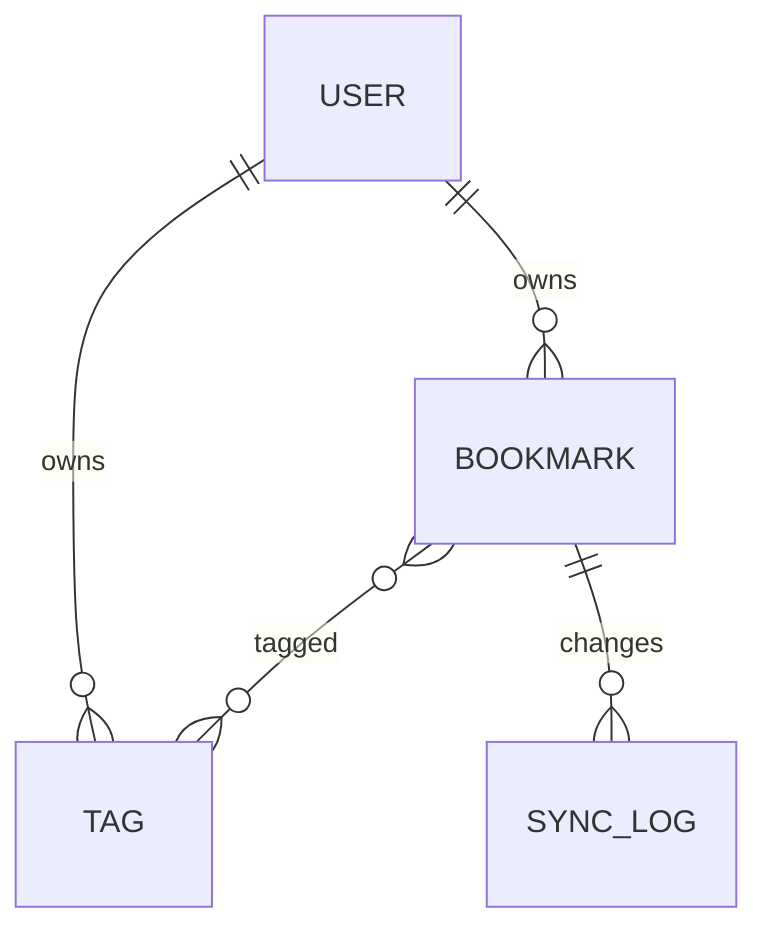

# データ設計

スキーマ定義の正は `src/storage/schema.sql`。ここでは概念モデルとライフサイクルを定める。

## 概念モデル

### Bookmark

URL・タイトル・本文抜粋・メモ・`fetch_status`・作成/更新日時・削除日時を持つ。
同一利用者内で URL は一意（正規化後の URL で判定する）。

### Tag

利用者ごとの名前空間を持つ。名前は小文字に正規化して保存する（REQ-0002）。
Bookmark とは多対多。タグが参照されなくなっても自動削除しない。

### SyncLog

Bookmark・Tag の変更を単調増加の版番号付きで記録する。同期の差分取得に使う（[同期設計](sync.md)）。

## ライフサイクル

| データ | 発生 | 増加ペース | 保持・削除 |
|---|---|---|---|
| Bookmark | 登録・インポート | 1利用者あたり月 50〜200 件 | 削除で `deleted_at` を設定し、30 日後に物理削除（REQ-0011） |
| Tag | 付与時 | 緩やか | 利用者が削除するまで保持 |
| SyncLog | 全変更 | Bookmark の約3倍 | 全端末が取得済みの版より古いものを日次で削除 |

## 整合性

- Bookmark の物理削除時は、関連する Tag の紐付けと検索インデックスの行を同一トランザクションで消す
- URL の正規化は保存前に1回だけ行う（`src/storage/url.py`）
